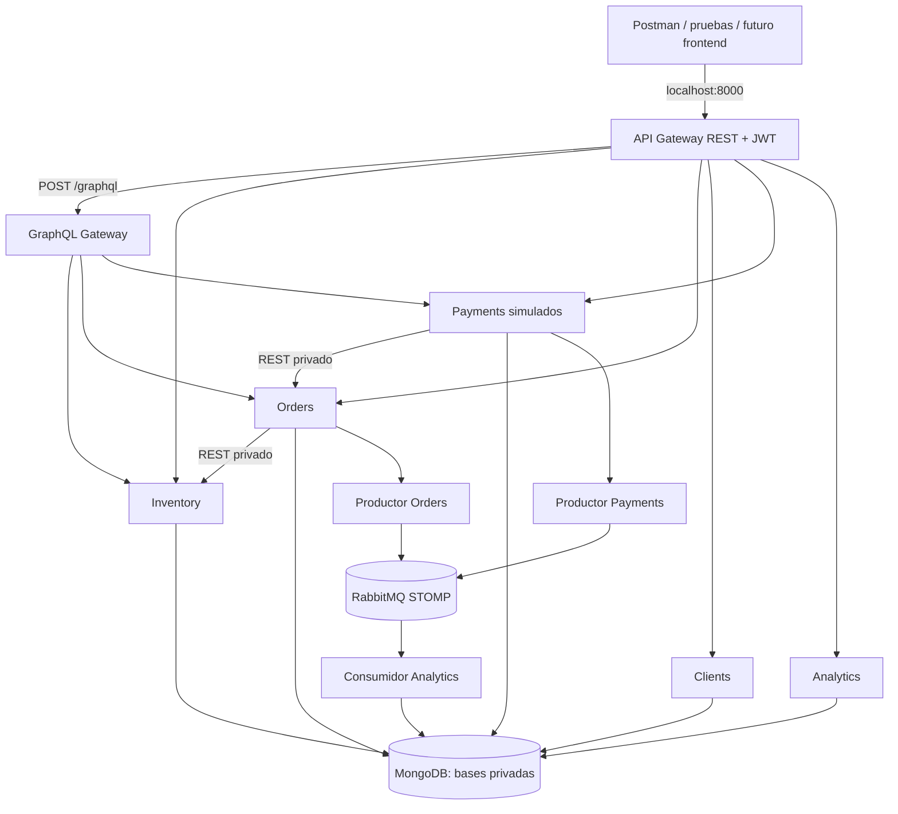

# Flor & Vida — Backend de florería

Proyecto Desarrollo Web y Móvil. Arquitectura Python/FastAPI + MongoDB + RabbitMQ STOMP + GraphQL, levantable localmente con Docker Compose. El frontend original está preservado, aún sin conectar al backend. Pagos exclusivamente **simulados**, no se cobra dinero real ni se piden tarjetas.

> **Verificación:** se ejecutaron pruebas locales de Docker Compose, REST, GraphQL, mensajería STOMP, Analytics y contratos de eventos en Windows con Docker Desktop y WSL 2. Las pruebas de integración se completaron correctamente en el equipo de desarrollo.

El backend fue ejecutado localmente en Windows mediante Docker Desktop, WSL 2 y Docker Compose.

Se completaron satisfactoriamente las siguientes comprobaciones:

- Inicio de los contenedores y verificación del estado saludable de MongoDB y RabbitMQ.
- Pruebas REST de inventario, autenticación, autorización, pedidos y pagos simulados.
- Pruebas GraphQL de catálogo, consultas de pedidos y pagos, y protección mediante JWT.
- Pruebas de integración de eventos STOMP mediante RabbitMQ, incluyendo aprobación de pagos ficticios y procesamiento por Analytics.
- Ejecución satisfactoria de scripts/smoke_test.py y scripts/smoke_test_stage2.py.
- Ejecución de las 3 pruebas unitarias disponibles mediante unittest.
- Comprobación de redes Docker internas para API, datos y mensajería.

Durante la validación se corrigió la compatibilidad de las dependencias GraphQL y se especificó el virtual host / en las conexiones STOMP.

Esta entrega incluye:

- **Servicios Inventory, Orders, Clients y Payments** con responsabilidades separadas.
- **CRUD y consultas** documentadas mediante REST.
- **Matriz de permisos HTTP** por stakeholder (`visitor`, `client`, `employee`, `admin`).
- **API Gateway REST** como entrada pública única.
- **GraphQL Gateway** para agregaciones entre servicios.
- **Separación pública y privada** demostrable con Docker Compose y redes internas.
- **Secretos de integración** generados localmente y documentados.
- **Protección de datos sensibles** y justificación de diseño.
- **Mensajería STOMP** y **servicio de analítica** desacoplado.
- **Justificación técnica de no usar gRPC** en esta iteración.
- **Frontend original preservado** para una integración posterior.

Consultar además:

- [docs/checklist_rubrica.md](docs/checklist_rubrica.md)
- [docs/decisiones_arquitectonicas.md](docs/decisiones_arquitectonicas.md)
- [docs/guion_demostracion.md](docs/guion_demostracion.md)

## 1. Requisitos

- Windows con Docker Desktop (Compose v2), o Linux/macOS con Docker Engine y el plugin `docker compose`.
- Python **3.10+** disponible en el host para generar secretos y ejecutar pruebas.
- Conexión a Internet **al construir por primera vez** imágenes Docker/instalar `cryptography`.
- Puerto `8000` del host disponible. No se necesita MongoDB, RabbitMQ ni Python instalado aparte del utilizado para secretos y pruebas.

## 2. Inicio rápido

Abre PowerShell o una terminal en esta carpeta (la que contiene `compose.yaml`).

```powershell
python -m pip install -r scripts/requirements.txt
python scripts/init_secrets.py
docker compose up -d --build
docker compose ps
python scripts/smoke_test.py
python scripts/smoke_test_stage2.py
```

El script `init_secrets.py` **conserva** secretos existentes; no borres `secrets/` si ya existe un volumen Mongo persistente. La primera ejecución de Docker puede tardar por las descargas. Si usas Windows y `python` no está disponible, prueba `py`.

**Puntos de acceso desde el host:**

- Salud: http://127.0.0.1:8000/health
- Catálogo público REST: http://127.0.0.1:8000/api/inventory/products
- Swagger del Gateway para auth y GraphQL: http://127.0.0.1:8000/docs
- GraphQL: `POST http://127.0.0.1:8000/graphql`, no se abre escribiendo esa URL en el navegador.

El único puerto publicado en Compose es **`127.0.0.1:8000`** de Gateway. No hay puertos de MongoDB, RabbitMQ ni de microservicios expuestos. HTTP está restringido a localhost; **no es un despliegue de Internet/producción**.

## 3. Arquitectura



**Redes Docker:** `edge` (solo Gateway), `private_api` (`internal: true`, Gateway y servicios), `private_data` (`internal: true`, Mongo y servicios de datos), `private_messaging` (`internal: true`, RabbitMQ y workers). GraphQL solo está en `private_api`, sin acceso a Mongo. Cada servicio de datos tiene su propia base Mongo y credencial. El consumidor se conecta exclusivamente a la base Analytics.

| Contenedor / proceso | Responsabilidad | Base o dependencia |
|---|---|---|
| `gateway` | única entrada pública, login, JWT RS256, REST proxy, proxy GraphQL | Clients, REST internos y GraphQL |
| `graphql` | agrega datos REST bajo autorización sin tocar Mongo | Inventory, Orders, Payments |
| `inventory` | catálogo, CRUD, stock y reservas atómicas por línea | `flor_inventory` |
| `orders` | crear/listar/consultar/cancelar pedidos, snapshot de precios | `flor_orders` |
| `clients` | registro, hash Argon2id, perfiles, roles | `flor_clients` |
| `payments` | pagos ficticios y aprobación/rechazo administrativo | `flor_payments` |
| `analytics` | métricas agregadas, solo administradores | `flor_analytics` |
| `order_producer`, `payment_producer` | publican eventos pendientes con confirmación STOMP | bases propias y RabbitMQ |
| `broker` | RabbitMQ con plugin STOMP, cola duradera | volumen `rabbit_data` |
| `analytics_consumer` | valida, persiste eventos anónimos y hace ACK | `flor_analytics`, broker |
| `mongo_provision` | crea usuario Analytics sin borrar volúmenes previos | Mongo root, tarea de un solo uso |
| `mongo` | persistencia y usuarios Mongo por dominio | volumen `mongo_data` |

La relación entre clases, el diagrama y las cardinalidades están en [docs/arquitectura.md](docs/arquitectura.md). El pago `Pedido 1 → 0..1 Pago` es una restricción de esta simulación, no un procesador real con reintentos/capturas.

## 4. API REST, perfiles y permisos

Base: `http://127.0.0.1:8000`. Roles: `visitor` (sin token), `client`, `employee`, `admin`. Las rutas `/api/...` del Gateway solo publican familias aprobadas y no permiten `internal` ni `/docs` privados.

| Operación | Ruta | Requisito |
|---|---|---|
| Registrar | `POST /auth/register` | público; rol siempre client |
| Autenticar | `POST /auth/login` | público |
| Consultar catálogo | `GET /api/inventory/products` | público |
| Crear/editar/desactivar producto | `POST, PATCH, DELETE /api/inventory/products[...]` | admin |
| Crear/consultar/cancelar pedido | `POST, GET, PATCH /api/orders/orders[...]` | cliente dueño o empleado/admin según operación |
| Gestionar perfil | `GET, PATCH /api/clients/clients/me` | autenticado, cuenta propia |
| Registrar/consultar pago | `POST, GET /api/payments/payments[...]` | dueño / rol autorizado |
| Aprobar/rechazar pago ficticio | `PATCH /api/payments/payments/{id}` | admin |
| Analítica resumen | `GET /api/analytics/analytics/summary` | admin |
| Top productos | `GET /api/analytics/analytics/products/top` | admin |
| Consultas GraphQL | `POST /graphql` | catálogo público; vista de pedido autenticada |

**Matriz completa** con permisos HTTP y ejemplos: [docs/rutas_y_permisos.md](docs/rutas_y_permisos.md). GraphQL, STOMP y analítica: [docs/graphql_eventos_analitica.md](docs/graphql_eventos_analitica.md).

### Usuarios de rol administrativo

En un terminal, luego de arrancar los contenedores:

```powershell
docker compose exec clients python -m app.admin_cli
```

El script privado solicita correo, nombre, contraseña y rol `admin` o `employee`. Nunca se aceptan roles enviados por `/auth/register`.

Ejemplo de cliente (`POST /auth/register`):

```json
{"nombre":"Cliente Ejemplo","email":"cliente@example.org","password":"ClaveSeguraDePrueba123!","telefono":"+56912345678"}
```

Tras `POST /auth/login` usa `Authorization: Bearer <access_token>` en solicitudes privadas.

Ejemplo de pedido (`POST /api/orders/orders`, con token):

```json
{"nombre":"Cliente Ejemplo","email":"cliente@example.org","telefono":"+56912345678","items":[{"product_id":"ramo-aurora","quantity":1}],"fecha":"2027-01-15","direccion":"Avenida de las Flores 123, Santiago","mensaje":"Feliz cumpleaños"}
```

El servidor valida fecha, calcula importe desde Inventory, reserva stock y genera número de pedido. Cambiar manualmente la fecha a una futura para la prueba. `POST /api/payments/payments` solo acepta `numero_pedido`; el monto lo consulta desde Orders. Un administrador puede marcar el pago `aprobado`, **sin cobro real**.

## 5. GraphQL + STOMP + analítica

**GraphQL** agrega pedidos y pagos con `orderOverview(orderNumber: String!)`; permite consultar productos públicos con `products`. Los permisos de propietario se comprueban en los servicios privados. Query de ejemplo:

```graphql
query($number: String!) {
  orderOverview(orderNumber: $number) {
    order { numeroPedido estado total items { productId quantity subtotal } }
    payment { id estado monto moneda }
  }
}
```

Enviar JSON al endpoint `POST /graphql` con `query` y `variables: {"number":"FV-..."}` y token de cliente.

**Mensajería STOMP**: creación de pedido → evento `order.created` → productor Orders → RabbitMQ → consumidor Analytics. Aprobación administrativa de pago ficticio → `payment.approved` → productor Payments → misma cola → consumidor. Los eventos contienen solo productos, importes e identificadores, **sin información identificatoria de clientes**. El outbox se guarda junto al registro de negocio para reintento y el consumidor almacena eventos con `event_id` único para evitar doble conteo.

**Analítica**: pedidos e importes solicitados, pagos simulados aprobados, e identificadores de productos más pedidos. Está aislada del detalle personal y usa consistencia eventual (segundos de retraso posibles). Para rangos, usar `?desde=2026-11-01&hasta=2026-11-30` (filtro UTC). Manual detallado y contratos de mensajes: [docs/graphql_eventos_analitica.md](docs/graphql_eventos_analitica.md).

**gRPC no se incorporó** porque el volumen y los contratos internos actuales no justifican duplicar el stack REST. La rúbrica pide gRPC si las necesidades lo justifican; la decisión de mantener REST se analiza en la documentación. No debe afirmarse que gRPC esté implementado.

## 6. Seguridad y secretos

Ejecuta **una sola vez** `python scripts/init_secrets.py`, y tantas veces como quieras sin borrar los archivos para completar nuevos secretos. Crea en `secrets/` las llaves JWT RSA, `service_token`, las contraseñas Mongo por servicio y `rabbitmq-password`.

- JWT RS256 de 30 minutos: **clave privada únicamente en Gateway**; pública en los microservicios que verifican JWT.
- Contraseñas de clientes almacenadas mediante Argon2id; nunca se devuelven hashes ni secretos.
- Servicios privados comprueban rol y propiedad; un cliente no puede leer un pedido ajeno cambiando la URL.
- Los mensajes de analítica omiten nombre, teléfono, correo, dirección, `client_id` y credenciales.
- Docker monta individualmente los secretos como archivos en modo solo lectura; el ZIP **no contiene** el directorio `secrets/`.
- La API no solicita ni guarda tarjeta, CVV o claves bancarias. Los pagos son simulaciones de aprendizaje.
- Vault del ejemplo antiguo no se utiliza en el despliegue actual. Generar secretos localmente es una decisión explícita para reproducibilidad académica, **no debe presentarse como integración activa con Vault**.

Consulta [docs/seguridad_y_secretos.md](docs/seguridad_y_secretos.md) para la tabla de secretos y limitaciones de producción. HTTP localhost y redes internas Docker **no sustituyen TLS ni controles de producción**.

## 7. Pruebas

```powershell
# Test etapa 1: CRUD básico, JWT, IDOR, pedido, pago ficticio
python scripts/smoke_test.py

# Test etapa 2: GraphQL público, consulta compuesta y auth
python scripts/smoke_test_stage2.py

# Test opcional de integración de analítica/eventos (requiere crear admin antes)
# PowerShell:
$env:ADMIN_EMAIL="admin@example.org"
$env:ADMIN_PASSWORD="TU_CLAVE_ADMIN"
python scripts/smoke_test_stage2.py
```

En Linux/macOS usa `export ADMIN_EMAIL=...` y `export ADMIN_PASSWORD=...`. La prueba opcional aprobará un pago **ficticio**, esperará la ingesta de eventos STOMP y consultará Analytics. Todas las smoke tests **crean cuentas y pedidos de prueba** y reservan stock. La prueba unitaria de eventos (se ejecuta dentro de contenedor con dependencias instaladas):

```powershell
docker compose exec orders sh -c "PYTHONPATH=. python -m unittest discover -s /usr/src/flor-vida/tests"
```

Como alternativa sin Docker, se puede ejecutar `PYTHONPATH=backend python -m unittest discover -s tests` en un entorno Python con `pydantic` instalado. El código de producción no depende del paquete `unittest` en ejecución normal.

## 8. Operación y solución de problemas

```powershell
docker compose ps
docker compose logs -f gateway graphql orders analytics broker order_producer analytics_consumer
docker compose down            # detiene sin borrar datos
docker compose up -d --build   # aplica cambios y conserva datos
# docker compose down -v      # ¡PELIGRO! elimina toda base y cola persistente
```

- **`mongo unhealthy`**: comprueba archivos en `secrets/` y logs Mongo. Si usaste la etapa 1, `mongo_provision` creará Analytics sin borrar bases anteriores. No regeneres claves de usuarios al conservar volumen.
- **`mongo_provision` falla**: revisa `docker compose logs mongo_provision` y que el root password sea el original.
- **`broker` unhealthy**: revisa `docker compose logs broker` y el secreto `rabbitmq-password`.
- **`502`**: algún servicio interno aún no responde; revisa `docker compose ps` y logs específicos.
- **`401`**: JWT inválido o vencido; vuelve a iniciar sesión.
- **`403`**: no tienes rol o propiedad del recurso solicitado.
- **GraphQL `errors`**: la consulta pudo completar HTTP 200 pero contener errores de autorización o sintaxis. Lee el campo `errors`.
- **Analytics 0 tras pedido**: evento pendiente; revisa `order_producer`, `analytics_consumer`, `broker`, y espera procesamiento asíncrono. Pago aprobado requiere un administrador.
- **Puerto 8000 ocupado**: cámbialo en el lado izquierdo de `gateway.ports`, por ejemplo `127.0.0.1:8001:8000`.

## 9. Limitaciones conocidas y siguientes mejoras

- Sin enlace al frontend por diseño de esta fase.
- JWT sin revocación/refresh y secreto interservicios compartido. Para Internet se necesita TLS, rate limit, registro de accesos, rotación de secretos, protección contra fuerza bruta y políticas de retención.
- Pago solo ficticio. Analítica representa compras solicitadas e ingresos **simulados**.
- Events outbox resuelve la publicación posterior a la creación/actualización de un documento y permite reintentos, pero **NO arregla** la reserva de stock transaccional entre Inventory/Orders; falta reconciliación/saga robusta y gestión de fallos permanente de mensajes.
- GraphQL, RabbitMQ y Analytics fueron probados con Docker Compose en el equipo de desarrollo. Estas verificaciones no equivalen a una certificación de producción.
- gRPC se descarta justificadamente para este caso; no hay streaming ni requisitos medidos de latencia que lo necesiten.
- Contraseñas locales Docker Compose y ausencia de Vault operativo: adecuadas solo a una demostración académica local. Si se requiere Vault explícito en la evaluación, habría que implementarlo como fase adicional.

## 10. Archivos

```text
Flor_y_Vida_Entrega_2/
├── frontend/               # frontend original sin tocar
├── backend/
│   ├── Dockerfile
│   ├── requirements.txt
│   └── app/
│       ├── gateway.py      # REST + JWT + proxy GraphQL
│       ├── graphql_gateway.py
│       ├── inventory.py
│       ├── orders.py
│       ├── clients.py
│       ├── payments.py
│       ├── analytics.py
│       ├── events.py
│       ├── messaging/{productor.py,consumidor.py}
│       ├── common.py
│       ├── catalog.py
│       └── admin_cli.py
├── docs/
│   ├── arquitectura.md
│   ├── rutas_y_permisos.md
│   ├── seguridad_y_secretos.md
│   └── graphql_eventos_analitica.md
├── rabbitmq/{Dockerfile,start.sh}
├── mongo-init/{create-users.sh,ensure-analytics-user.sh}
├── scripts/{init_secrets.py,smoke_test.py,smoke_test_stage2.py,requirements.txt}
├── tests/test_event_contracts.py
├── compose.yaml
├── .dockerignore
├── .gitignore
└── README.md
```

**IMPORTANTE:** los archivos de código antiguos bajo `legacy/` no forman parte de este paquete de entrega. La versión activa del consumidor y productor está en `backend/app/messaging/`.
