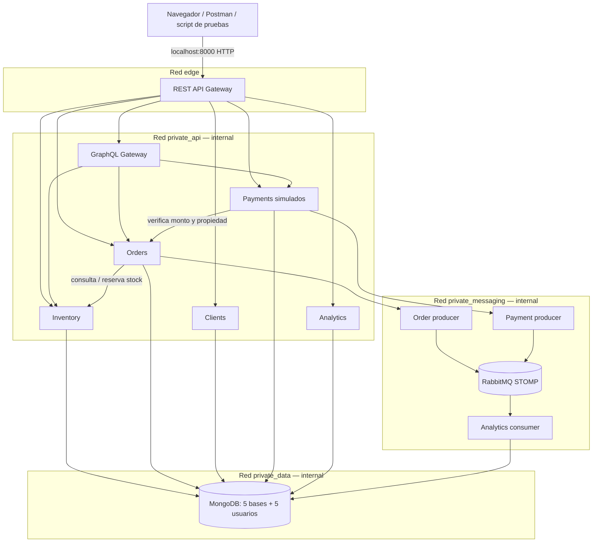
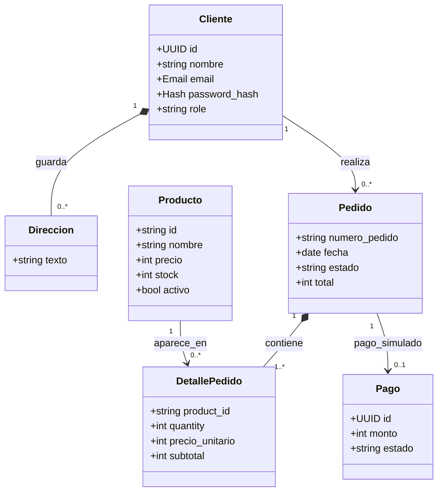

# Arquitectura de Flor & Vida — etapas 1 y 2

## Decisión
Docker Compose local con el Gateway como único puerto público (`127.0.0.1:8000`).
Por el momento el frontend está copiado **sin integrar**.

Los contenedores tienen IP privadas de Compose. Los servicios no publican puertos; las rutas `/internal/*` no se proxifican desde el Gateway. El usuario web solo accede a `GET /api/inventory/products` sin credenciales, o se autentica para otras operaciones.

## Servicios y datos

- **Inventory** es el dueño de `flor_inventory`: productos y reservas. Semilla de 9 productos desde el JS original.
- **Orders** es el dueño de `flor_orders`: pedidos, detalles e importes históricos. Reserva stock con Inventory mediante HTTP privado.
- **Clients** es el dueño de `flor_clients`: perfiles y contraseñas con hash Argon2id.
- **Payments** es el dueño de `flor_payments`: transacciones ficticias. Nunca se aceptan números de tarjeta, CVV ni un monto calculado por el navegador.

Analytics es dueño exclusivo de `flor_analytics`: métricas derivadas de eventos sin datos personales. Los productores acceden solo a su base de origen y al broker privado, no a bases ajenas. La clave JWT **privada** solo está montada en Gateway. Los servicios reciben la clave pública y verifican firma, audiencia, emisor, vigencia y rol. MongoDB asigna un usuario `readWrite` distinto a cada base.

## Diagrama de clases y cardinalidades

MongoDB no exige foreign keys: se conserva `client_id` en el pedido, `product_id` en cada detalle y `numero_pedido` en el pago, validados por los servicios. El pedido conserva **snapshot** de nombre y precio del producto para evitar que cambios posteriores alteren los montos históricos. `Dirección` se embebe como lista simple de texto en Client; el pedido guarda su propia dirección de entrega.

## Contratos de integración

Inventario informa precio y disponibilidad a Orders, y permite reserva atómica de cada producto. Payments consulta Orders de forma interna para comprobar dueño, estado y monto del pedido. Los mensajes internos requieren secreto separado del JWT. Las APIs privadas no están expuestas fuera de la red Docker.

## Requisitos incorporados en etapa 2 y límites

1. **GraphQL Gateway:** implementa `products` y `orderOverview(orderNumber)` usando llamadas REST privadas, preservando autorización por propietario. Consultas y límites en [graphql_eventos_analitica.md](graphql_eventos_analitica.md).
2. **Mensajería STOMP:** eventos `order.created` y `payment.approved` publicados con outbox embebido, receipt y consumo idempotente. Las plantillas originales siguen preservadas en `legacy/`.
3. **Analítica:** base Mongo separada con resúmenes agregados y productos más pedidos, admin-only, sin nombre/correo/domicilio.
4. **gRPC:** no incorporado justificadamente; volumen pequeño, sin streaming y REST interno suficiente.
5. **Consistencia de stock:** sigue pendiente una saga de recuperación para reserva de Inventario / inserción de pedido y cancelaciones; los eventos outbox no equivalen a una transacción distribuida.
6. **Seguridad de producción:** sin TLS de Internet, refresh/revocación JWT ni limitación distribuida de peticiones. El mecanismo compartido `service_token` es de alcance académico.
