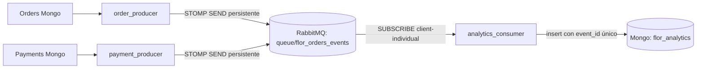

# GraphQL, mensajería STOMP y analítica — Etapa 2

## 1. Gateway GraphQL (consultas agregadas)

Exposición pública: **únicamente `POST http://127.0.0.1:8000/graphql`** con cuerpo `application/json`.
El proceso GraphQL vive dentro de `private_api` (`graphql:8000`) y no tiene credenciales ni conexión Mongo.
Solo consulta los REST privados Inventory, Orders y Payments; los JWT se verifican tanto en Gateway como en los servicios que aplican RBAC y comprobación de propietario.

| Campo raíz | Parámetros | Protección | Combina |
|---|---|---|---|
| `products` | ninguno | Público | Inventory, datos vigentes de catálogo |
| `orderOverview` | `orderNumber: String!` | Bearer; propietario o personal autorizado según servicio | Orders + Payments |

Ejemplo de consulta pública:

```bash
curl -s http://127.0.0.1:8000/graphql -H 'Content-Type: application/json' \
  --data '{"query":"{ products { id nombre precio stock } }"}'
```

Ejemplo de consulta privada (reemplazar `TOKEN` y `NUMERO`):

```bash
curl -s http://127.0.0.1:8000/graphql \
  -H 'Content-Type: application/json' -H 'Authorization: Bearer TOKEN' \
  --data '{"query":"query($number:String!){orderOverview(orderNumber:$number){order{numeroPedido estado total items{productId quantity subtotal}}payment{id estado monto moneda}}}","variables":{"number":"NUMERO"}}'
```

Los nombres de propiedades GraphQL utilizan **camelCase** (`numeroPedido`, `precioUnitario`). La consulta puede devolver `payment: null` cuando un pedido no tiene pago registrado. En GraphQL, los errores de autorización suelen tener HTTP 200 y un campo `errors`; por tanto, validar siempre ambos.

Controles de consumo: solo POST JSON, entrada máxima 16 KiB, máximo 5 niveles, 10 aliases y 1500 tokens del documento. Sin IDE público ni WebSocket. Se utiliza Strawberry 0.316.0, posterior a la corrección de validación de alias en versiones anteriores a 0.315.7.

## 2. STOMP: adaptación del productor y consumidor

`backend/app/messaging/productor.py` y `consumidor.py` **son implementaciones activas**, diferentes de las plantillas conservadas en `legacy/`.



1. Orders crea el pedido y `_outbox.event` **en el mismo documento y escritura** Mongo; Payments inserta `_outbox.event` al aprobar un pago.
2. Un productor por base examina eventos pendientes y hace `SEND` persistente a `/queue/flor_orders_events`.
3. El broker confirma el mensaje con `RECEIPT` (después de confirmar persistencia). Solo entonces se marca `_outbox.sent_at`.
4. El consumidor valida el contrato Pydantic, elimina duplicados usando índice único de `event_id`, inserta y envía ACK individual.
5. Si hay un corte antes del ACK, el mensaje se reentrega. Los duplicados son esperados, pero no alteran métricas. El proceso se reconecta si se pierde RabbitMQ.

**Garantía:** publicación de tipo *al menos una vez*, con tratamiento idempotente del consumidor. No se prometen transacciones distribuidas ni orden estricto de mensajes. Las inserciones inválidas se rechazan y se descartan (NACK sin reencolar); para producción se necesitaría cola de fallos y alertas. Las reservas de inventario aún usan compensación y necesitan una saga/conciliación más fuerte.

**Contrato `order.created`**:

```json
{
  "event_id": "11111111-2222-4333-8444-555555555555",
  "event_type": "order.created",
  "occurred_at": "2026-11-09T20:00:00+00:00",
  "numero_pedido": "FV-2026-123456789ABC",
  "total": 18990,
  "items": [{"product_id": "ramo-aurora", "quantity": 1, "subtotal": 18990}]
}
```

**Contrato `payment.approved`** (simulado): `event_id`, `event_type`, `occurred_at`, `numero_pedido`, `total`.

No se transmiten nombres, correos, números telefónicos, direcciones, `client_id` ni credenciales. RabbitMQ no expone STOMP, AMQP ni panel al host, y está únicamente en `private_messaging`. La contraseña de broker se crea localmente.

## 3. Consultas de analítica

Analítica tiene base y usuario Mongo dedicados (`flor_analytics`, `analytics_user`), separados de las bases operacionales. No lee directamente los pedidos ni los pagos.

| Endpoint público por Gateway | Rol | Resultado |
|---|---|---|
| `GET /api/analytics/analytics/summary` | `admin` | conteo de pedidos, importe total de pedidos, pagos aprobados, ingresos simulados CLP |
| `GET /api/analytics/analytics/products/top?limit=5` | `admin` | productos con más unidades pedidas, importe total de sus líneas |

Ambos aceptan opcionalmente `desde=AAAA-MM-DD&hasta=AAAA-MM-DD` en fechas **UTC**. Las métricas son *eventualmente consistentes*: puede existir retraso mientras se publican y procesan los eventos. Los importes de pedidos no son cobros efectivos; `ingresos_simulados_clp` cuenta solamente los eventos `payment.approved` (sin dinero real).

## 4. Por qué NO se incorporó gRPC

La comunicación síncrona Orders → Inventory y Payments → Orders representa pocas llamadas por operación, con contratos REST JSON ya implementados. Introducir gRPC aquí aumentaría contenedores, generación de `.proto`, observabilidad y mantenimiento sin una necesidad comprobada de rendimiento o streaming. El requisito de la asignatura pide gRPC **cuando se justifique**: en el caso actual se justifica mantener REST privado y STOMP asíncrono. Si en el futuro se necesitaran cientos de verificaciones de stock por segundo o comunicación tipada de baja latencia, sería candidato razonable migrar `Inventory.CheckAvailability` a gRPC; en ese caso habría que implementar autenticación servicio-servicio y TLS mutuo, no solo añadir un `.proto`.

## 5. Control de cambios de la etapa

- GraphQL: `backend/app/graphql_gateway.py` y nueva ruta `gateway.py`.
- Eventos: `backend/app/events.py`, cambios en `orders.py` y `payments.py`.
- Productor y consumidor: `backend/app/messaging/`.
- Analytics: `backend/app/analytics.py`.
- Infraestructura: `rabbitmq/Dockerfile`, `rabbitmq/start.sh`, nuevas redes/servicios Compose, usuario Analytics.
- Pruebas: `tests/test_event_contracts.py`, `scripts/smoke_test_stage2.py`.
